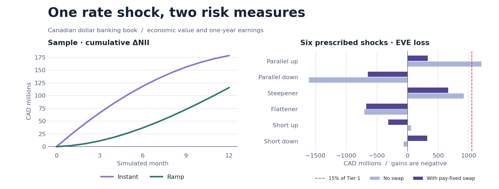

# Canadian banking-book interest rate risk simulator

[Open the interactive simulator](https://y68wu.github.io/irrbb-lab/#simulator) · [Read the four-week project handbook](https://y68wu.github.io/irrbb-lab/handbook.html)

**A CAD 10B pay-fixed swap cut the worst six-shock EVE loss from CAD 1.207B to CAD 665M, or from 17.24% to 9.49% of Tier 1.** With the same hedge, a 200 bp rate decline pushed one-year ΔNII from −CAD 148M to −CAD 348M. The first swap notional that clears the 15% screen on the CAD 0.5B grid is CAD 2B.



## Reproduce

Requires Node.js 22 or later. The browser and command-line reports use the same JavaScript pricing engine and committed Bank of Canada curve snapshot. Model runs and tests work offline.

```bash
npm test
npm run report
python3 -m http.server 8000 --directory docs
```

The [analysis notebook](notebooks/01_irrbb.ipynb) loads the committed reports and can re-run them using Node. To regenerate the overview figure, install `requirements-analysis.txt` and run `python3 scripts/plot_report.py`. The optional market-data refresh uses Python and curl. [Source data and methods](data/README.md).

## Opening banking book

This fictional October-year-end bank has CAD 100B assets, CAD 93B liabilities and CAD 7B Tier 1 capital. RBC and TD's public disclosures anchor the standalone HELOC share within retail secured lending. Remaining weights, coupons and behavioral assumptions are illustrative. [Bank disclosures and calibration](data/README.md#synthetic-bank).

| Assets | CAD B | Liabilities | CAD B |
| --- | ---: | --- | ---: |
| Fixed mortgages | 32 | Core non-maturity deposits | 31 |
| Variable mortgages | 22 | Non-core non-maturity deposits | 16 |
| HELOC | 5 | GICs | 30 |
| Commercial loans | 27 | Wholesale funding | 16 |
| Government of Canada securities | 14 | | |

Fixed mortgage cohorts have 1–60 months until renewal and an assumed 25-year amortization. Scheduled principal and monthly prepayments run off, with any remaining balance resetting at renewal. The monthly prepayment probability is `1 − (1 − CPR)^(1/12)`. GoC securities are split 10% / 25% / 65% across 2 / 6 / 15 years. The long GoC position is a deliberate synthetic source of duration. GIC vintages cover original terms of 1–5 years. Core deposit balances decay exponentially in EVE, with a terminal residual in year 15. Non-core deposits reprice in one month. The [repricing gap](reports/repricing_gap.csv) buckets principal at runoff or next reset and shows cumulative gaps.

## Economic value of equity

The engine discounts scheduled asset and liability cash flows at interpolated Bank of Canada zero yields and adds the swap PV. It treats floating-rate principal at its next reset. EVE uses the opening book in runoff and retains contract coupons. The five-year pay-fixed, receive-floating swap is priced at par on the opening curve. The swap has no opening EVE impact.

The six prescribed shapes use CAD magnitudes of **200 bp parallel, 275 bp short and 175 bp long**. Short shocks decay as `exp(−tenor/4)`. Steepener and flattener mix the short and long components. The OSFI post-shock floor is **−75 bp**. At the updated calibration, final OSFI B-12 applies from November 1, 2026 for October-year-end institutions and January 1, 2027 for December-year-end institutions. The screen compares the worst adverse ΔEVE across the six full-size shocks to **15% of Tier 1**. See [OSFI B-12 Annex 1 and paragraph 81](https://www.osfi-bsif.gc.ca/en/guidance/guidance-library/interest-rate-risk-management-guideline-2027) and [BCBS SRP31](https://www.bis.org/committees/bcbs/basel-framework/standard/srp/31/inforce/2026-01-01/published/2024-07-16).

## Twelve-month NII

The balance sheet holds product balances constant by replacing principal that prepays, matures or renews. Floating instruments reset on the short-rate move. Fixed replacements use their pricing tenor. Core deposit rates pass through the selected fraction of the short move, with non-core pass-through set to 1.5 times that beta and capped at 100%. Product coupons are floored at zero. The swap contributes realized monthly net interest, and ΔNII compares against the same hedge in the unchanged-rate baseline.

With the website sample, +200 bp produces the same terminal **−CAD 374M ΔEVE** under both timings, while 12-month ΔNII is **+CAD 178M** for an immediate move and **+CAD 116M** for a linear ramp. Each monthly EVE point revalues the opening runoff book at that point's curve. NII accumulates over the chosen path. The two measures are separate views of rate risk. The UI also lets users apply non-parallel shapes to NII as exploratory scenarios. B-12 prescribes parallel up/down for NII. [Sample replay paths](reports/sample_path.csv).

## Validation and sensitivity

- Changing core deposit decay from 2 to 6 years moves the modeled worst EVE loss from **28.02% to 9.64% of Tier 1**. Raising deposit beta from 20% to 75% changes parallel-up ΔNII from **+CAD 368M to −CAD 197M**. These sensitivities reflect separate behavioral channels. [Behavior table](reports/behavior_sensitivity.csv).
- The same synthetic book produces worst losses of **17.24% to 26.23% of Tier 1** over the four historical starting curves. These are curve-vintage sensitivities. [Starting curve comparison](reports/curve_regimes.csv).
- More swap notional is not always better for the six-shock screen. The [hedge sweep](reports/hedge_sweep.csv) shows when the adverse scenario changes and how parallel-down earnings move.

## Limitations

- Product cohorts, margins, capital and behavior are synthetic. CPR and decay are input assumptions held fixed across shocks. The model omits endogenous prepayment incentives, NMD migration, credit losses and customer rate competition.
- EVE uses one risk-free discount curve and includes existing cash-flow margins. It applies a reset-bucket approximation to floating balances. No basis curve, spread shocks, capital deductions or regulatory reporting templates are included.
- NII uses monthly bucket repricing and a static balance sheet. It excludes growth, changing mix, fee income and hedge-accounting treatment. Simulated months are a user-controlled scenario playback rather than observed results.
- The Bank of Canada input is a published fitted zero curve. The project interpolates that curve directly. The 15% comparison is an educational screen on a simplified bank.
